# À Mesa — pedidos por QR code 🍽️

> © 2026 Carlos. Todos os direitos reservados. Ver [LICENSE](LICENSE).

Sistema de pedidos para restaurantes, demonstrado com o restaurante fictício **Tasca do Zé**.
O cliente lê o QR code da mesa, escolhe os pratos, envia o pedido e pode pagar no telemóvel.
A cozinha vê o pedido chegar ao vivo e, quando muda o estado, o cliente vê a mudança.

Projeto final (Projeto 4 — Open Project): aplicação full-stack com **3 serviços separados** (front-end, API e base de dados), cada um no seu contentor Docker.

| Cliente: menu da mesa | Cliente: carrinho | Cliente: estado do pedido |
|---|---|---|
| 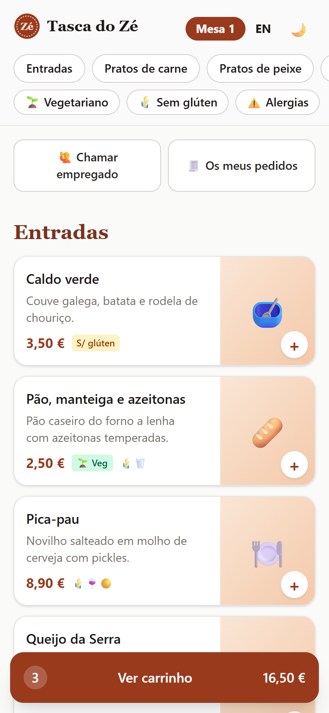 | 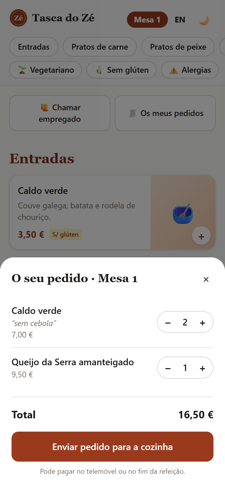 | 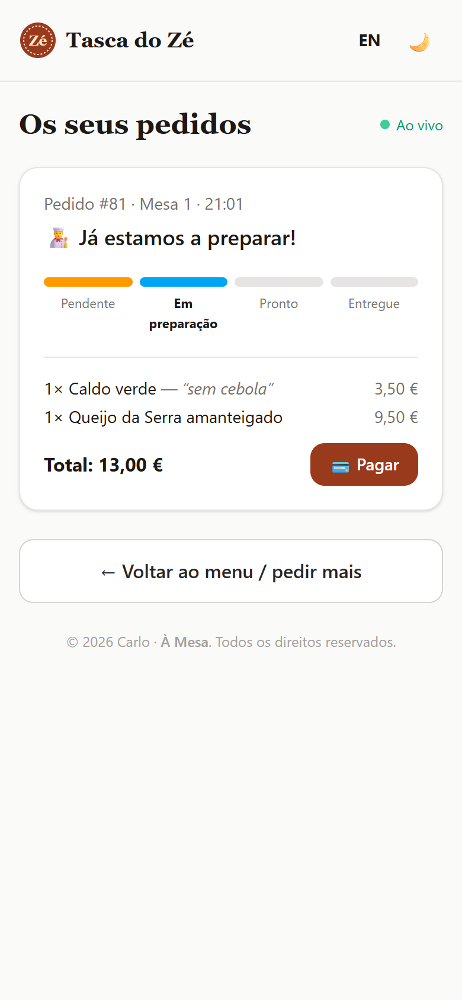 |

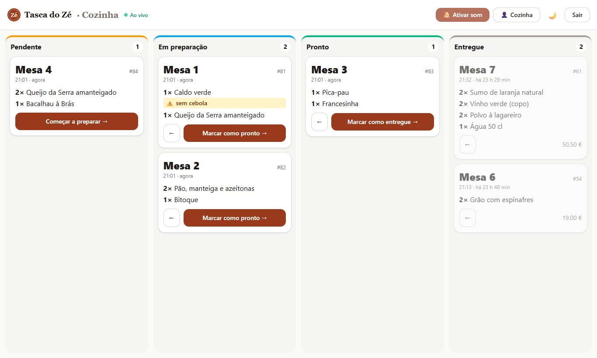

<details>
<summary>Mais capturas de ecrã (administração, login, modo escuro)</summary>

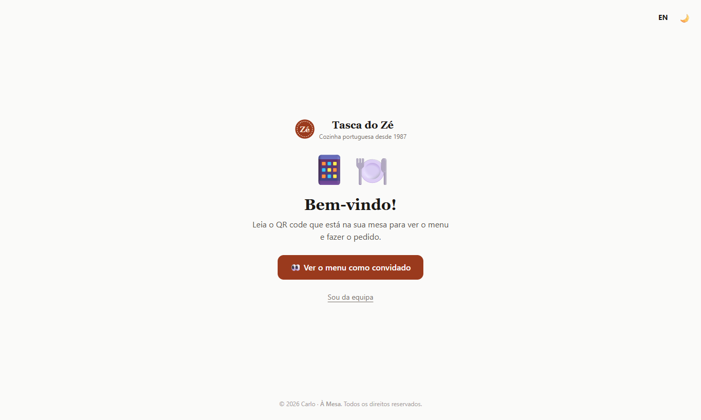
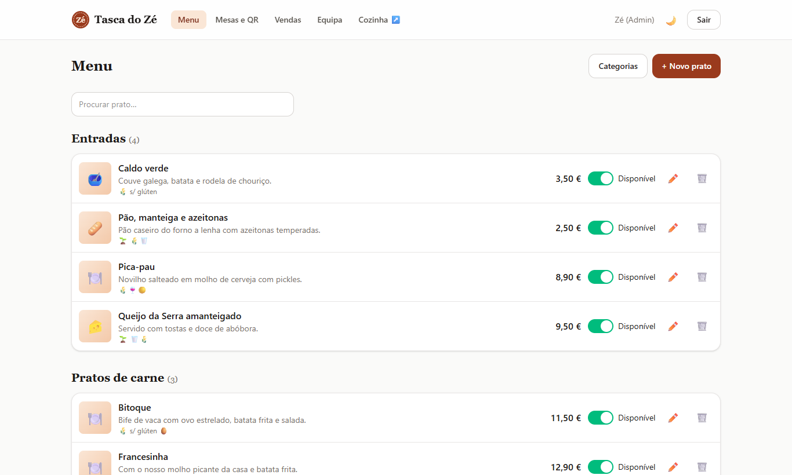
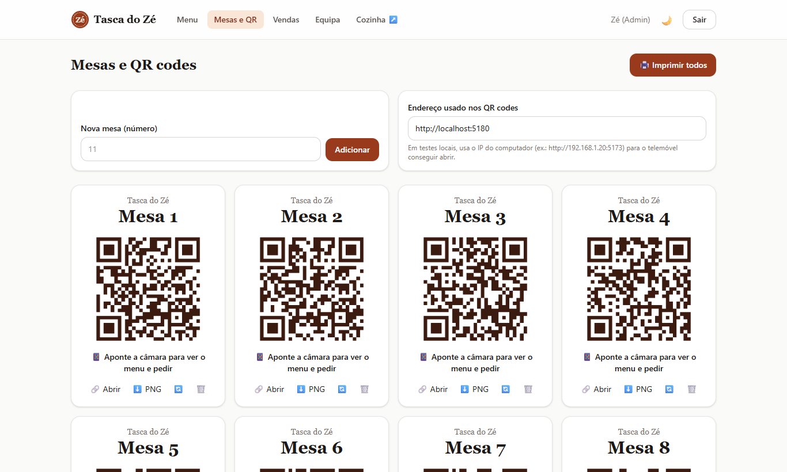
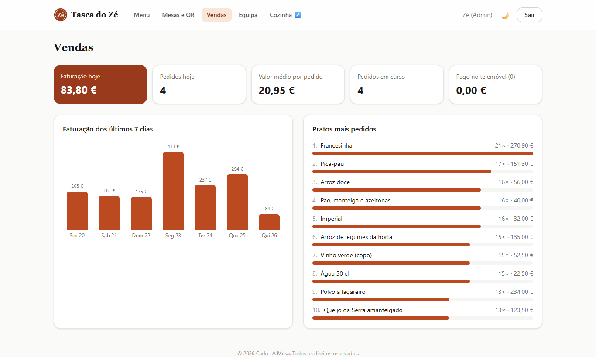

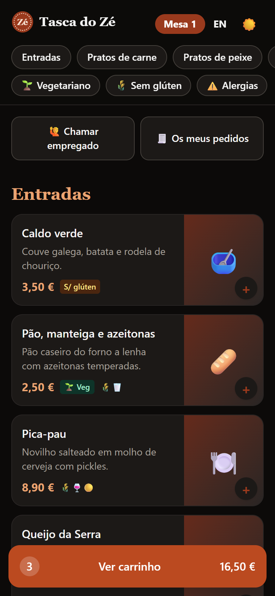

</details>

## Arrancar com Docker (máquina limpa)

Precisas apenas do **Docker** (Docker Desktop no Windows/macOS).

```bash
docker compose up --build
```

Abre **http://localhost:8080**. O compose arranca os 3 serviços, aplica as migrações e cria os dados de exemplo (menu, 10 mesas, contas de teste e vendas dos últimos 7 dias).

| Serviço | Contentor | Endereço |
|---|---|---|
| Front-end (React compilado, servido pelo nginx) | `web` | http://localhost:8080 |
| API (Express + Socket.IO) | `api` | http://localhost:4000/api/saude |
| Base de dados (PostgreSQL 17) | `db` | só na rede interna do compose |

Para parar: `docker compose down`. Para apagar também os dados: `docker compose down -v`.

### Contas de teste

| Papel | Email | Palavra-passe | O que pode fazer |
|---|---|---|---|
| Admin | admin@tascadoze.pt | admin123 | tudo: menu, mesas e QR, vendas, equipa, cozinha |
| Cozinha | cozinha@tascadoze.pt | cozinha123 | painel da cozinha |
| Cliente | — | — | não faz login: abre o QR de uma mesa (Admin → Mesas e QR) ou "Ver como convidado" |

> Estas contas só existem em desenvolvimento e no `docker compose`. Em produção não são criadas: a **primeira conta registada** no site fica admin.

## Arrancar sem Docker (desenvolvimento)

Precisas apenas do **Node.js 20+**. A base de dados PostgreSQL vem incluída, sem instalar nada.

```bash
npm run setup     # instala as dependências (só da primeira vez)
npm run dev       # base de dados + API + site
```

Abre **http://localhost:5180**. Da primeira vez são criados o menu, 10 mesas e as [contas de teste](#contas-de-teste). O site recarrega sozinho quando mudas o código.

Portas: site `5180`, API `4000`, PostgreSQL local `5433`. Os dados ficam em `server/.pgdata/`. Apaga essa pasta para recomeçar do zero.
Se já tiveres outro PostgreSQL configurado em `server/.env`, usa `npm run dev -- --sem-db`.

> **npm 11 (allow-scripts):** as aprovações de scripts necessárias (Prisma, esbuild e o PostgreSQL para Windows) estão nos `package.json`.
> Em macOS ou Linux, corre `npm approve-scripts --allow-scripts-pending` na raiz depois do `npm run setup`.

### Testar com o telemóvel

1. Liga o PC e o telemóvel à mesma rede Wi-Fi.
2. O `npm run dev` mostra um endereço "Network", por exemplo `http://192.168.1.20:5180`.
3. Em **Admin → Mesas e QR**, põe esse endereço no campo "Endereço usado nos QR codes".
4. Lê o QR code com o telemóvel.

## Arquitetura

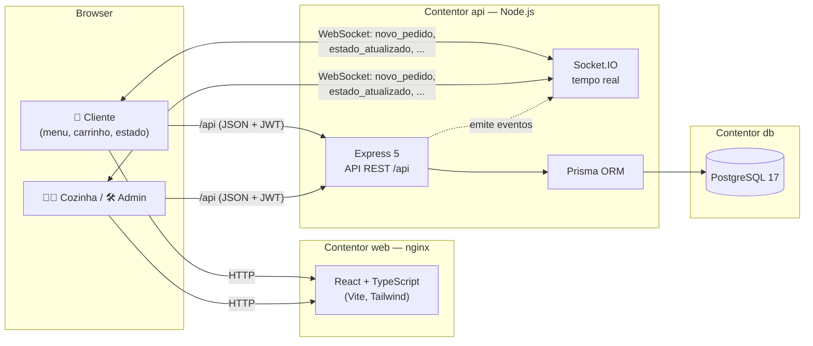

- **Front-end** (`client/`): SPA em React. Em produção é um conjunto de ficheiros estáticos servidos pelo nginx (Docker) ou pelo Vercel.
- **API** (`server/`): Express com validação Zod em todas as entradas, autenticação JWT e Socket.IO no mesmo servidor HTTP. Cada alteração relevante (pedido novo, estado, menu) é emitida para a sala certa: `equipa`, `admins` ou `pedido:<id>`.
- **Base de dados**: PostgreSQL, acedida só pela API através do Prisma. A estrutura evolui por **migrações versionadas** em `server/prisma/migrations/`.
- No Docker, o nginx encaminha `/api`, `/uploads` e `/socket.io` para a API. O browser fala sempre com a mesma origem.

### Modelo de dados

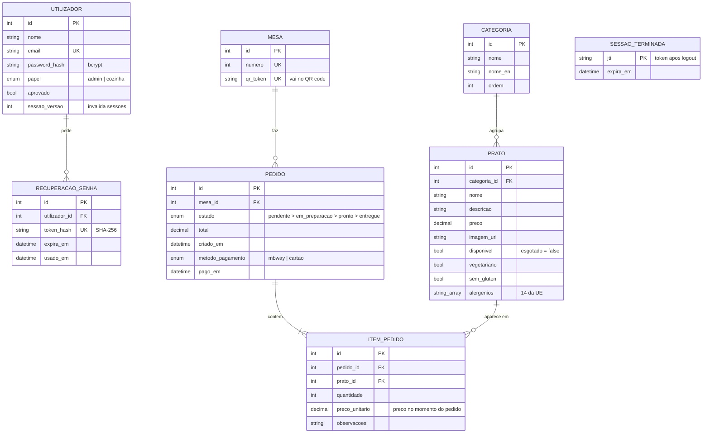

**Porquê PostgreSQL (e não MongoDB)?** Os dados são muito relacionais: um pedido pertence a uma mesa, tem itens, e cada item aponta para um prato. As chaves estrangeiras garantem a consistência, por exemplo não é possível apagar um prato que já foi pedido. As transações garantem que um pedido e os seus itens são gravados juntos ou não são gravados. O `DECIMAL` evita erros de arredondamento nos preços. E as estatísticas de vendas são consultas de agregação (`SUM`, `GROUP BY`), que é onde o SQL é mais forte. O `preco_unitario` fica guardado em cada item, para que mudar o preço de um prato não altere os pedidos antigos.

**Migrações** (`server/prisma/migrations/`, aplicadas com `prisma migrate deploy`):

| Migração | O que muda |
|---|---|
| `20261126000000_init` | tabelas base: utilizadores, categorias, pratos, mesas, pedidos, itens |
| `20261126141621_contas_e_recuperacao` | aprovação de contas, versão de sessão, recuperação de senha |
| `20261126142359_alergenios_idiomas_pagamento` | traduções EN, dieta, alergénios, pagamento simulado |
| `20261126200000_sessoes_terminadas` | logout no servidor (lista de tokens terminados) |

## Funcionalidades

**Cliente (sem login)**
- QR code da mesa → menu dessa mesa (`/mesa/:token`)
- **Ver como convidado** (`/menu`): consultar o menu sem mesa. Não dá para fazer pedidos.
- Pratos por categoria, com foto, preço, descrição e indicação de "esgotado"
- **Filtros:** 🌱 vegetariano, 🌾 sem glúten e "tenho alergia a…", com os 14 alergénios da UE
- **Português / English** (botão PT/EN). Os pratos podem ter tradução própria.
- Carrinho com quantidades e observações ("sem cebola")
- Estado do pedido em tempo real (`/mesa/:token/pedido`)
- **Pagamento simulado** com MB WAY ou cartão (ver mais abaixo)
- Botão **"Chamar empregado"**
- O menu atualiza-se sozinho quando o admin muda um preço ou esgota um prato
- Modo escuro

**Equipa**
- **Criar conta** (`/registar`): a primeira conta do sistema fica admin. As seguintes aguardam aprovação do admin.
- **Login / logout**: o logout invalida o token no servidor, e não apenas no browser.
- **Recuperar senha** (`/recuperar-senha`): link por email, de uso único, válido 30 minutos. Sem email configurado, o admin pode gerar o link em *Equipa*.
- Mudar a própria senha (cozinha e admin)

**Cozinha**
- Painel ao vivo em colunas: Pendente → Em preparação → Pronto → Entregue
- Muda o estado com um clique, com botão para recuar se houver engano
- Aviso sonoro para pedidos novos e chamadas de empregado
- Destaque das observações, dos pedidos atrasados (mais de 20 min) e dos pedidos já pagos

**Administração**
- Menu: categorias e pratos, esgotados, fotos, tradução inglesa, dieta e alergénios
- Mesas e QR codes: descarregar em PNG, imprimir todos, gerar novo QR
- Vendas: faturação do dia, valor pago no telemóvel, últimos 7 dias, pratos mais pedidos
- Equipa: aprovar ou recusar contas, mudar papéis, suspender, remover, gerar link de senha

## Segurança

| Ameaça | Proteção |
|---|---|
| Adivinhar senhas | Limite de 10 tentativas **falhadas** por IP a cada 15 min, e de 20 por **conta** a cada hora (trava ataques vindos de muitos IPs). bcrypt com custo 12. Tempo de resposta igual quer o email exista quer não. |
| Ficar dono do site no lançamento | Em produção, a 1.ª conta (admin) exige o `CODIGO_CONFIGURACAO` secreto do servidor |
| Fugir aos limites com IPs falsos | O `X-Forwarded-For` só é aceite atrás de um proxy real (`TRUST_PROXY`, 1 no Render e 0 em local) |
| Senhas fracas | Mínimo de 8 caracteres, com letras e números (validado no servidor) |
| Descobrir quem tem conta | "Recuperar senha" responde sempre o mesmo |
| Alguém registar-se e entrar na cozinha | Contas novas ficam pendentes até o admin aprovar |
| Sessões roubadas ou antigas | JWT HS256 de 12 h, verificado na BD a cada pedido. O **logout** põe o token numa lista de sessões terminadas, por isso uma cópia dele deixa de servir. Mudar a senha, o papel ou suspender **termina todas as sessões** e **corta logo a ligação em tempo real** (Socket.IO). |
| Links de recuperação | Token de 256 bits; só o hash SHA-256 é guardado. Uso único e 30 min de validade. |
| Alterar preços pelo cliente | O cliente envia só IDs e quantidades. Os preços vêm sempre da BD. |
| Ver pedidos de outras mesas | Consultar e acompanhar um pedido exige o token do QR da mesa |
| Pedidos falsos em massa | Limite por mesa (10 pedidos/min), não por IP: as mesas não se bloqueiam umas às outras no Wi-Fi do restaurante |
| Uploads maliciosos | Só JPG, PNG, WEBP e GIF até 5 MB, confirmados pelos primeiros bytes do ficheiro. Nome aleatório. |
| URLs perigosos nas imagens | Só são aceites `https://`, `http://` ou `/uploads/…` (bloqueia `javascript:` e `data:`) |
| XSS, clickjacking | React escapa o texto. Helmet na API. CSP sem scripts inline, `X-Frame-Options: DENY` e HSTS no Vercel. |
| Outros sites a usar a API | CORS limitado a `FRONTEND_URL` (obrigatório em produção) |
| Ataques sem rasto | Registo de segurança (`[seguranca]` nos logs): logins falhados, bloqueios, contas criadas, papéis alterados, senhas redefinidas. Nunca regista senhas. |
| Base de dados exposta na rede | O PostgreSQL local só aceita ligações do próprio PC (`localhost`) |
| Erros que revelam o interior | Respostas de erro genéricas, sem stack traces. Pedidos gigantes → 413. |
| Má configuração em produção | O servidor recusa arrancar sem `JWT_SECRET` (32+ caracteres) e sem `FRONTEND_URL` |
| Dados de cartão | O pagamento é simulado: os dados só são validados no browser e **nunca são enviados**. O servidor recusa pedidos com campos a mais. |

`npm audit`: 0 vulnerabilidades no servidor e no cliente.

**O que continua a depender de ti:** senhas fortes para as contas reais, guardar o `CODIGO_CONFIGURACAO` e o `JWT_SECRET` em segredo (nunca no GitHub), manter as dependências atualizadas (`npm audit`) e reimprimir os QR codes se uma foto deles circular (**Mesas → 🔄**).

## Qualidade: lint, testes e CI

```bash
npm run lint            # ESLint em todo o projeto (front-end, back-end, scripts e testes)
npm test                # todos os testes (back-end + front-end)
npm run test:backend    # só os 97 testes da API
npm run test:frontend   # só os 14 testes do front-end
```

**Back-end — 97 testes** (`testes/`): correm contra servidores reais, com uma base de dados temporária, uma API em modo desenvolvimento e outra em modo **produção**. Tudo é apagado no fim, e os teus dados em `server/.pgdata` não são tocados.

| Ficheiro | O que testa |
|---|---|
| `testes/1-funcionalidades.test.mjs` | menu, pedidos e cozinha em tempo real, preços, pagamento, administração |
| `testes/2-seguranca.test.mjs` | permissões, tokens forjados, login/logout, contas, recuperação de senha, sessões cortadas, uploads maliciosos, limites de tentativas |
| `testes/3-producao.test.mjs` | código de configuração da 1.ª conta, CORS, HTTPS, ataque distribuído a uma conta |

**Front-end — 14 testes** (`client/src/**/*.test.ts(x)`, Vitest + Testing Library):

| Ficheiro | O que testa |
|---|---|
| `lib/api.test.ts` | envio do token, mensagens de erro do servidor, fim de sessão em 401, sem ligação |
| `lib/pagamento.test.ts` | validação de cartão (Luhn), validade, MB WAY e CVV |
| `lib/formatar.test.ts` | preços em euros, "há 15 min" |
| `components/componentes.test.tsx` | mostrar/ocultar senha, troca PT/EN, aviso de direitos de autor |

**CI no GitHub Actions** (`.github/workflows/ci.yml`), em cada Pull Request e em cada push para a `main`:
1. **Lint, tipos e testes**: ESLint, TypeScript, os 14 testes do front-end, os 97 do back-end (num PostgreSQL de serviço) e o build de produção.
2. **docker compose up**: constrói e arranca os 3 contentores e confirma que o site, a API, os dados de exemplo e o login respondem.

### Pagamento simulado

Não há nenhum processador de pagamentos real. O servidor só regista o método (MB WAY ou cartão) e a hora.
Para testar com cartão, usa **4242 4242 4242 4242**, uma validade futura (ex.: 12/29) e qualquer CVV.
Para MB WAY, usa qualquer número com 9 dígitos começado por 9.
Para pagamentos reais seria preciso integrar um serviço como SIBS, Stripe ou easypay.

## Tecnologias

| Parte | Ferramenta |
|---|---|
| Front-end | React 19 + TypeScript (Vite), React Router 7, Tailwind CSS 4 |
| Back-end | Node.js + Express 5 + TypeScript, Zod, Helmet, express-rate-limit |
| Base de dados | PostgreSQL com Prisma 6 (local: `embedded-postgres`) |
| Tempo real | Socket.IO |
| Login | JWT + bcrypt (`bcryptjs`) |
| Email | Nodemailer (qualquer SMTP) |
| QR codes | `qrcode` |
| Imagens | Cloudinary, ou Multer para o disco local |
| Contentores | Docker + Docker Compose (nginx para o front-end) |
| Qualidade | ESLint, Vitest + Testing Library, testes de integração da API, GitHub Actions |
| Deploy | Vercel (front-end) + Render (back-end e base de dados) |

## Estrutura

```
docker-compose.yml          os 3 serviços: web (nginx), api (Node), db (PostgreSQL)
.github/workflows/ci.yml    CI: lint + testes + docker compose em cada Pull Request
docs/api.http               documentação da API, com pedidos prontos a executar
docs/screenshots/           capturas de ecrã
eslint.config.mjs           regras de lint de todo o projeto
dev.mjs                     arranque local sem Docker (BD + API + site)
scripts/db-local.mjs        PostgreSQL embutido para desenvolvimento
testes/                     testes da API (back-end) + executor
server/
  Dockerfile                imagem da API (aplica migrações + seed ao arrancar)
  prisma/schema.prisma      utilizadores, recuperacoes_senha, sessoes_terminadas, categorias, pratos, mesas, pedidos, itens_pedido
  prisma/migrations/        migrações SQL
  prisma/seed.ts            dados de exemplo da Tasca do Zé (PT + EN + alergénios)
  src/index.ts              Express + Helmet + CORS + Socket.IO
  src/seguranca.ts          senhas, validação, limites de tentativas
  src/routes/               auth, utilizadores, menu, mesas, pedidos, pratos, categorias, estatisticas, upload
client/
  Dockerfile, nginx.conf    imagem do front-end (build do Vite servido pelo nginx)
  src/pages/                MenuMesa, EstadoPedido, Login, Conta (registo/recuperação), Cozinha, Admin*
  src/**/*.test.ts(x)       testes do front-end
  src/lib/idioma.tsx        textos PT/EN e alergénios
  vercel.json               rotas da SPA e cabeçalhos de segurança
render.yaml                 blueprint de deploy no Render
```

## API

A documentação completa, com exemplos de pedidos e respostas que podes executar, está em **[docs/api.http](docs/api.http)**. Abre-a no VS Code com a extensão *REST Client* e carrega em "Send Request".
Os erros vêm sempre como `{ "erro": "mensagem legível" }` com o código HTTP certo (400, 401, 403, 404, 409, 413 ou 429), e o front-end mostra essa mensagem ao utilizador.

| Método | Rota | Acesso | Descrição |
|---|---|---|---|
| POST | `/api/auth/login` | público | `{ token, utilizador }` |
| POST | `/api/auth/sair` | equipa | logout: o token deixa de ser aceite |
| GET | `/api/auth/eu` | equipa | dados da sessão atual |
| POST | `/api/auth/registar` | público | cria conta (1.ª = admin; restantes pendentes) |
| POST | `/api/auth/recuperar` | público | envia link de recuperação |
| GET/POST | `/api/auth/redefinir[/:token]` | público, com token | valida o link / grava a nova senha |
| POST | `/api/auth/alterar-senha` | equipa | muda a própria senha |
| GET | `/api/menu` | público | categorias com pratos (PT/EN, alergénios) |
| GET | `/api/mesas/:token` | público | confirma a mesa |
| POST | `/api/mesas/:token/chamar` | público | chama o empregado → `chamar_empregado` |
| POST | `/api/pedidos` | público | cria o pedido → `novo_pedido` |
| GET | `/api/pedidos/:id?token=` | público, com token da mesa | estado de um pedido |
| POST | `/api/pedidos/:id/pagar` | público, com token da mesa | pagamento simulado → `estado_atualizado` |
| GET | `/api/pedidos?estado=` | cozinha/admin | pedidos das últimas 24 h |
| PATCH | `/api/pedidos/:id/estado` | cozinha/admin | muda o estado → `estado_atualizado` |
| CRUD | `/api/pratos`, `/api/categorias`, `/api/mesas` | admin | gestão; alterações ao menu → `menu_atualizado` |
| GET/PATCH/DELETE | `/api/utilizadores[/:id]` | admin | gestão da equipa |
| POST | `/api/utilizadores/:id/link-recuperacao` | admin | gera link de senha |
| POST | `/api/upload` | admin | campo `imagem` → `{ url }` |
| GET | `/api/estatisticas` | admin | vendas |

## Deploy

Tudo no **Render**, com um só Blueprint ([render.yaml](render.yaml)) que cria os 3 serviços: base de dados, API e site.

1. Entra em **https://dashboard.render.com** com a conta do GitHub.
2. Carrega em **New → Blueprint**, escolhe o repositório `a-mesa` e depois **Apply**. Os campos opcionais (`SMTP_URL`, `CLOUDINARY_URL`) podem ficar vazios.
3. Espera que os 3 serviços fiquem **Live**. Demora uns 5 a 10 minutos da primeira vez.
4. Confirma os endereços. Se o Render tiver acrescentado letras aos nomes, acerta duas variáveis e faz **Manual Deploy**:
   - `a-mesa-tasca-api` → `FRONTEND_URL` = endereço do site
   - `a-mesa-tasca` → `VITE_API_URL` = endereço da API
5. **Contas de teste:** são as mesmas (admin@tascadoze.pt e cozinha@tascadoze.pt), mas com **senhas aleatórias**. Vês os valores em `a-mesa-tasca-api` → **Environment** → `DEMO_SENHA_ADMIN` e `DEMO_SENHA_COZINHA`. Dá-as ao professor em privado e nunca as escrevas no GitHub.

O `JWT_SECRET` e as senhas são gerados pelo Render, por isso nenhum segredo fica no repositório. O https é automático, e o site tem os mesmos cabeçalhos de segurança do [client/vercel.json](client/vercel.json).

> **Plano grátis:** a API adormece ao fim de 15 min sem uso, e o primeiro pedido a seguir demora cerca de 1 minuto. Abre o site uns minutos antes da apresentação. A base de dados grátis expira ao fim de cerca de 30 dias, e as fotos carregadas apagam-se a cada deploy (usa `CLOUDINARY_URL` para as guardar).
>
> O front-end também pode ir para o **Vercel** (Root Directory `client`, variável `VITE_API_URL`), que usa o [client/vercel.json](client/vercel.json).

**Endereço público:** _(acrescentar aqui depois do deploy)_

## Forma de trabalhar

- Cada funcionalidade nasce como cartão no **Trello** (Backlog · Sprint · Em curso · Em revisão · Feito), com critérios de aceitação.
- Trabalho em **branches** (`feat/...`, `fix/...`). Nada entra na `main` sem **Pull Request** revisto por outro membro e com a CI verde.
- Mensagens de commit em **Conventional Commits**, por exemplo `feat: chamar empregado`, `fix: limite de pedidos por mesa`, `test: logout`, `docs: README`.
- Só dados fictícios (seeds). O restaurante Tasca do Zé, o menu e as contas são inventados.

## Guião da apresentação

1. Projeta o QR code de uma mesa e pede a alguém do júri para fazer um pedido. Mostra o botão **EN** e os filtros de alergias.
2. Tem a **cozinha** aberta noutro ecrã, com o **som ativado**. O pedido aparece com aviso sonoro.
3. Avança o pedido na cozinha. O telemóvel do júri mostra "Em preparação…" e depois "Pronto".
4. O júri **paga com MB WAY** (simulado) e a cozinha vê a etiqueta "PAGO".
5. Carrega em **"Chamar empregado"**. A cozinha recebe o alerta.
6. Fecha com o **admin**: muda um preço ou esgota um prato, e o menu no telemóvel atualiza-se logo. Termina no painel de **Vendas**.

## Direitos de autor

© 2026 Carlos. **Todos os direitos reservados.** Ver [LICENSE](LICENSE).

É proibido copiar, modificar, distribuir ou usar este projeto comercialmente sem autorização escrita do autor.
Os docentes e o júri podem instalá-lo e analisá-lo apenas para o avaliar.
As bibliotecas de código aberto usadas mantêm as suas próprias licenças.
